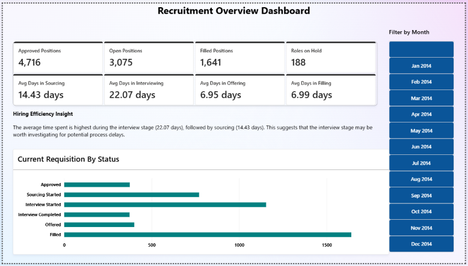
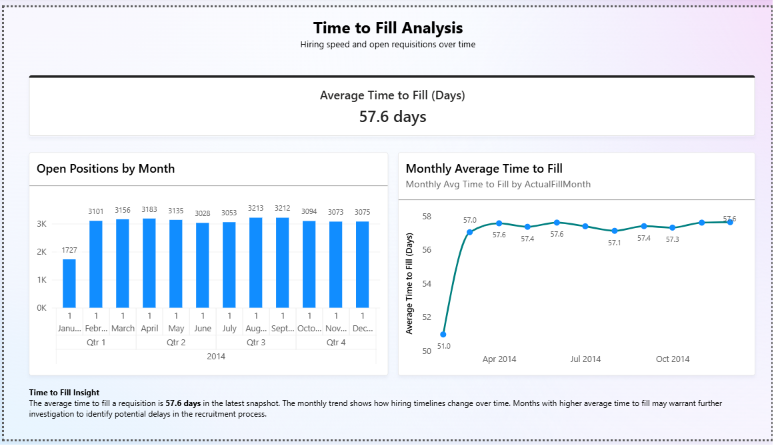
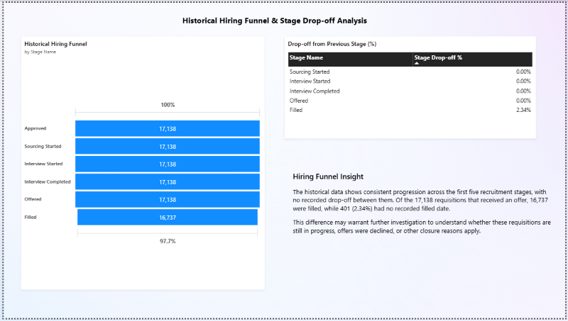

# Hiring Funnel & Pipeline Analytics Dashboard

## Project Overview

This Power BI project analyses recruitment data to provide visibility into hiring progress, pipeline movement, and delays across the recruitment lifecycle.

The data was available in month-wise files, making it difficult to get a consolidated view of requisitions, monitor stage progression, and identify bottlenecks. The objective was to build an interactive dashboard that supports better hiring reviews and data-driven decision-making.

## Business Objectives

- Track requisitions across the hiring lifecycle.
- Monitor current requisition status and hiring progress.
- Identify gaps in progression between recruitment stages.
- Analyse the time taken at different stages of the hiring process.
- Monitor open positions and overall time to fill.
- Enable analysis by month and relevant business dimensions.

## Dataset Overview

Each record represents a job requisition, identified by a requisition ID.

The dataset includes:

- Requisition ID
- Approval date
- Sourcing start date
- Interview start date
- Interview completion date
- Offer date
- Filled date
- Business Unit
- Region
- Role
- Hiring Status

The data consists of month-wise hiring files and includes requisition-level updates over time.

## Tools & Technologies

- **Power BI Desktop** – Dashboard development and visualisation
- **Power Query** – Data cleaning, transformation, and consolidation
- **DAX** – Measures, calculations, and analytical logic
- **DAX Studio** – Measure dependency analysis and model cleanup

## Data Preparation & Transformation

The following activities were performed:

1. Combined month-wise hiring files using the Power BI Folder Connector.
2. Reviewed data quality issues, including duplicate requisition IDs and incomplete date fields.
3. Standardised column names and date formats.
4. Addressed non-month files and inconsistent source filenames during date extraction.
5. Created a snapshot date to support current-state analysis.
6. Reviewed filters and transformation steps to ensure all relevant monthly data was included.

## Data Model & Analytics

The project uses a requisition-level hiring data table along with a stage lookup table.

The stage lookup table contains recruitment stage names and their sequence, helping maintain the correct order of stages in funnel analysis.

### Key Dashboard Metrics

| Metric                         | Purpose                                                                               |
| ------------------------------ | ------------------------------------------------------------------------------------- |
| Hiring Funnel                  | Tracks requisitions across recruitment stages                                         |
| Stage Drop-off %               | Measures the proportion of requisitions not recorded at the next stage                |
| Current Requisitions by Status | Shows the latest requisition status                                                   |
| Open Positions                 | Tracks approved positions that are not yet filled, excluding positions marked On Hold |
| Average Stage Duration         | Measures the average time spent at different hiring stages                            |
| Average Time to Fill           | Measures the average number of days between approval and filling                      |

## Dashboard Analysis

### 1. Historical Hiring Funnel

Provides a stage-wise view of hiring progression:

Approved → Sourcing Started → Interview Started → Interview Completed → Offered → Filled

The analysis helps identify where requisitions are not progressing as expected.

### 2. Current Requisition Status

Uses the latest available snapshot to show the current distribution of requisitions across hiring stages.

This provides an operational view of the active hiring pipeline rather than relying only on cumulative historical stage counts.

### 3. Stage Duration & Time to Fill

Analyses the time taken at different stages of the recruitment process and the overall time between requisition approval and filling.

These metrics can help identify delays and areas where process improvements may be required.

## Key Analytical Considerations

- Historical stage counts and current requisition status represent different views of the hiring process and should not be interpreted interchangeably.
- Stage drop-off indicates that a requisition has no recorded progression to the next stage in the dataset; it does not necessarily mean the candidate was rejected.
- Latest-snapshot calculations are used for current-state reporting.
- Open-position calculations account for filled and On Hold status conditions.
- KPI values may change based on month selection and report filters.

## Business Value

The dashboard provides a consolidated view of recruitment activity and helps HR teams and hiring stakeholders:

- Monitor hiring pipeline health.
- Identify stages where progression is slowing down.
- Review stage-wise delays.
- Track open requisitions and hiring completion.
- Support more structured, data-driven hiring discussions.

## Skills Demonstrated

- Data cleaning and transformation
- Power Query
- Data modelling
- DAX measures and filter context
- Snapshot-based reporting
- Recruitment funnel analysis
- KPI development
- Data validation and troubleshooting
- Dashboard design and analytical problem-solving

## Project Files

- `Employee Hiring PowerBI dashboard.pbix` – Power BI dashboard file
- `HiringData.zip` – Source dataset, subject to applicable sharing permissions
- `Screenshots/` – Dashboard previews
- `Documentation/` – Project overview and dashboard documentation (PDF prepared for portfolio presentation)
---

## Project Documentation

For a detailed overview of the dashboard, key metrics, visual analysis and business observations, refer to:

[Download Recruitment Analytics Dashboard Documentation](Documentation/Power_BI_Recruitment_Analytics_Dashboard.pdf)

## Dashboard Preview

### 1. Recruitment Overview

### 2. Time to Fill Analysis

### 3. Historical Hiring Funnel

**Note:** This is a portfolio project developed to demonstrate Power BI and recruitment analytics capabilities. The findings are based on the available dataset and its recorded requisition updates.
